# Navigation Structure

This document shows which screens Patikanos has and how the user moves between them. It reflects the code after the onboarding, map fixes and design-system changes; screens that are planned but not built yet are drawn with dashed borders.

## Tabs

On first launch the app opens on `OnboardingScreen` (`lib/screens/onboarding_screen.dart`, three pages). After that it opens on `HomeScreen` (`lib/screens/home_screen.dart`), which holds a bottom navigation bar with five tabs. Tabs keep their state when you switch between them (`IndexedStack`).

| Tab | Screen | File | Purpose |
|---|---|---|---|
| Bugün | `TodayScreen` | `lib/screens/today_screen.dart` | Pick an activity, see today's best time, featured routes |
| Keşfet | `ExploreScreen` | `lib/screens/explore_screen.dart` | Search and filter all routes |
| Harita | `MapScreen` | `lib/screens/map_screen.dart` | Start points of all routes on an OpenStreetMap map |
| Favoriler | `FavoritesScreen` | `lib/screens/favorites_screen.dart` | Routes the user marked with ♥ |
| Profil | `ProfileScreen` | `lib/screens/profile_screen.dart` | User info, preferences, settings |

## Flow diagram

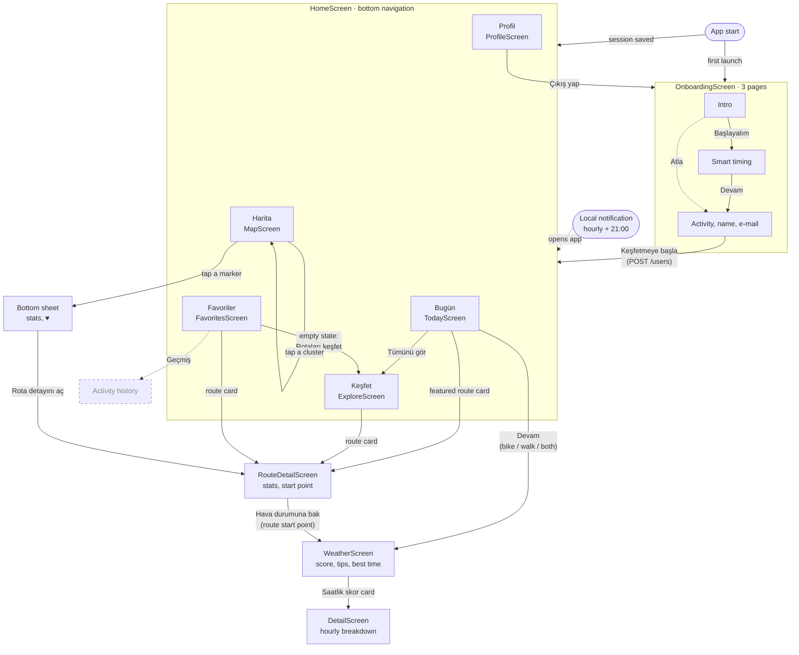

## Screenshots

Taken on an iPhone 17 Pro Max simulator with the backend running. To refresh them after a UI change, start the backend (`docker compose up`) and run:

```sh
flutter drive --driver=test_driver/integration_test.dart \
  --target=integration_test/screenshots_test.dart -d <device>
# shrink for the repo (macOS): PNG -> JPEG
cd docs/screenshots && for f in *.png; do sips -Z 1434 -s format jpeg -s formatOptions 78 "$f" --out "${f%.png}.jpg" && rm "$f"; done
```

| Onboarding 1 | Onboarding 2 | Onboarding 3 |
|---|---|---|
| 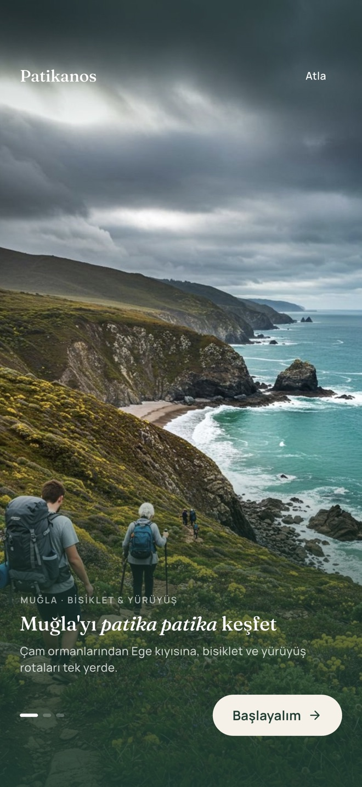 | 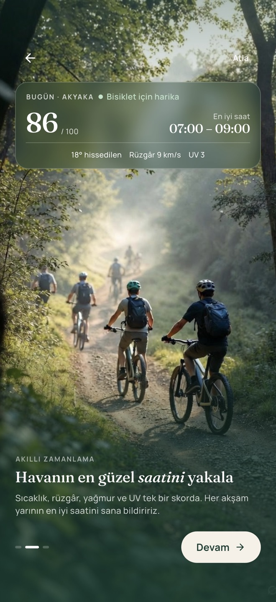 | 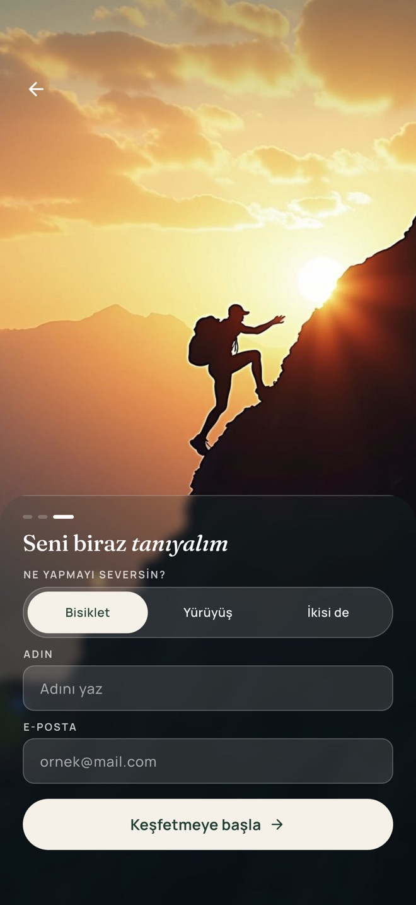 |

| Bugün | Weather (both) | Hourly detail | Keşfet |
|---|---|---|---|
| 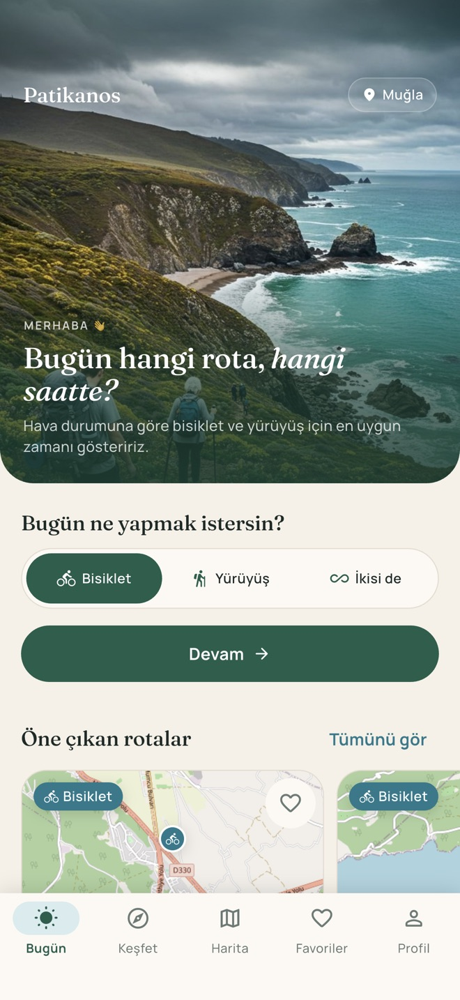 | 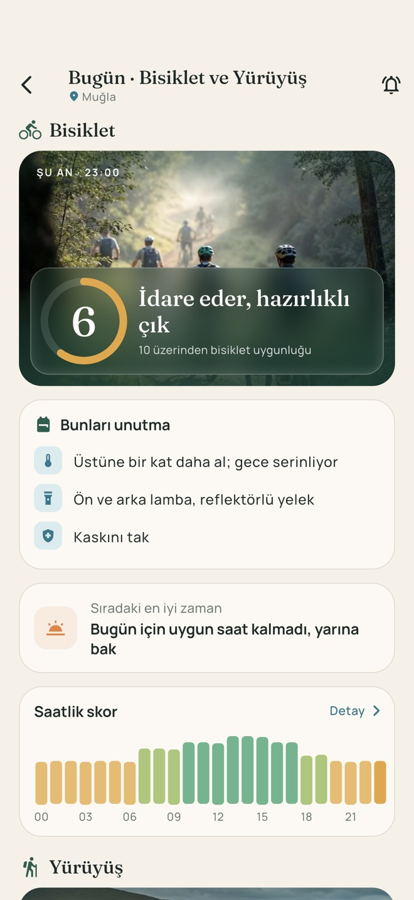 | 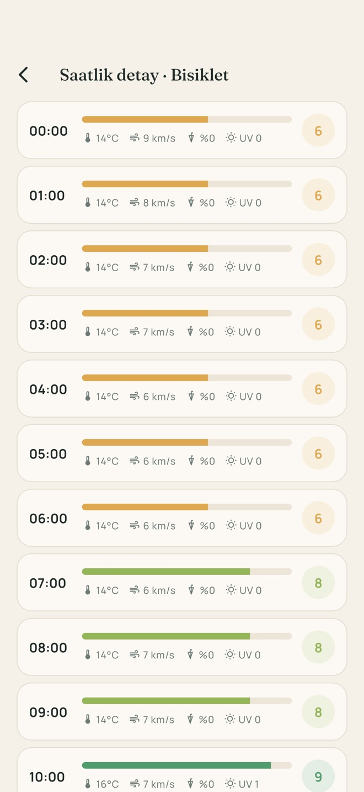 | 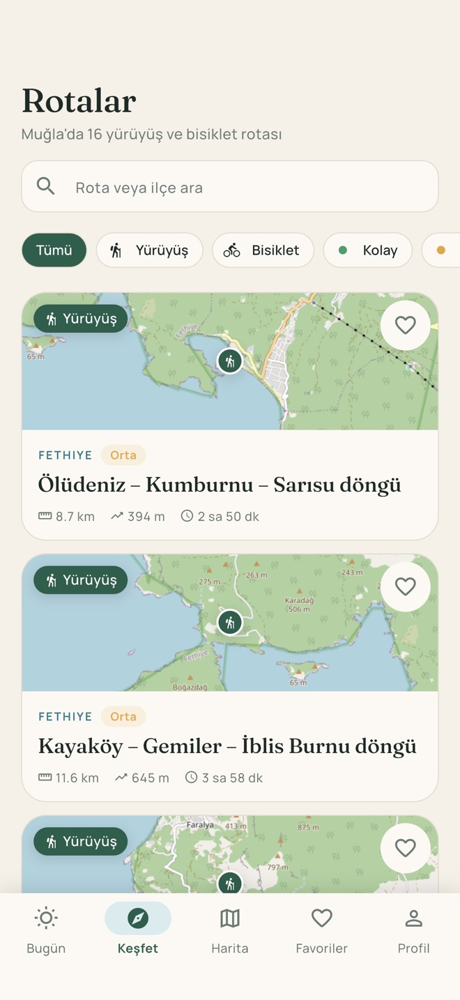 |

| Route detail | Harita | Favoriler | Profil |
|---|---|---|---|
| 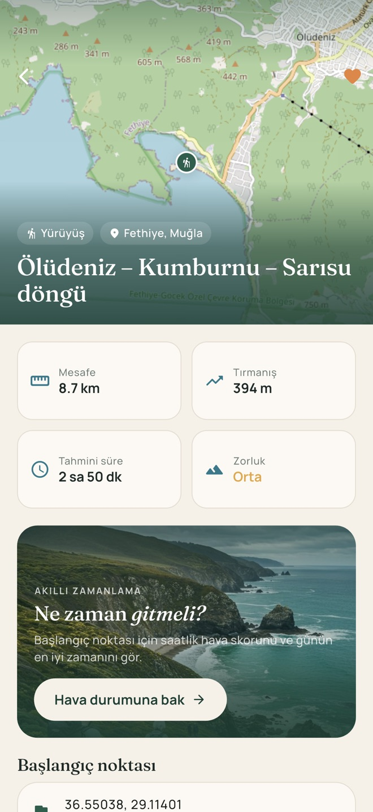 | 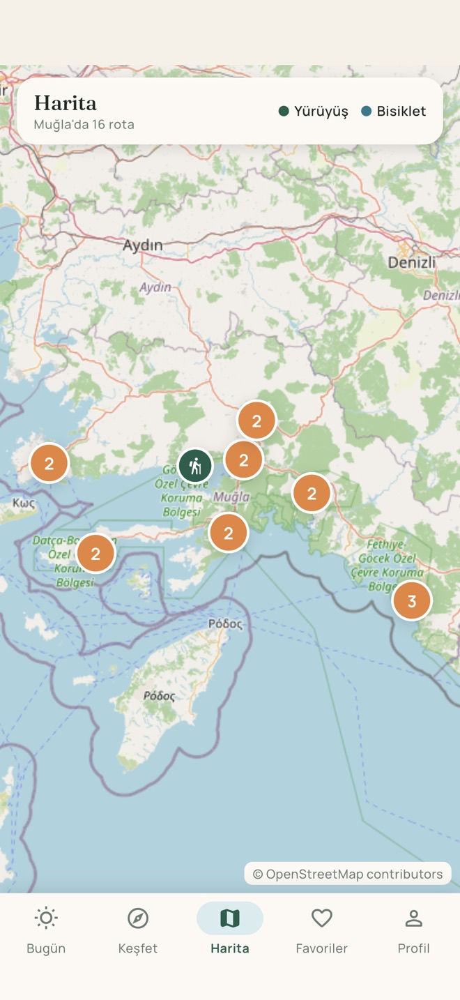 | 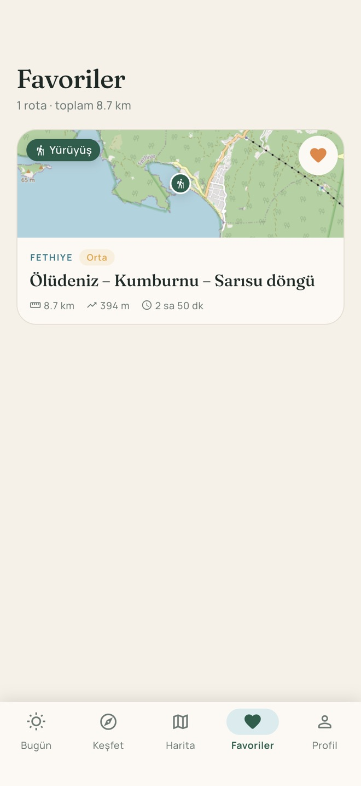 | 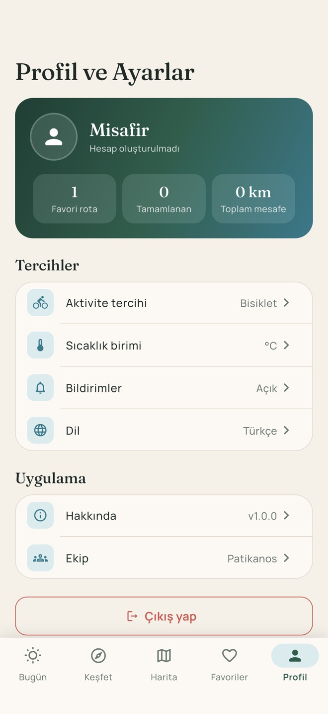 |

## Actions that do not navigate

| Where | Action | Effect |
|---|---|---|
| Route card, route detail | ♥ button | Adds/removes the route from Favoriler (in memory, see `lib/data/favorites.dart`) |
| Keşfet | Search box, filter chips | Filters the list in place |
| Route detail | Start point tile | Copies coordinates to the clipboard |
| Weather screen | 🔔 button | Sends a test notification after 5 seconds |
| Profil | Settings rows | Not implemented yet (placeholder) |

## Planned screens

| Screen | Owner | Status |
|---|---|---|
| Route lines on the map | Esma Gül Baş | `geometry` is still empty in the route data; only start points are shown |
| Activity history (Geçmiş) | UI/UX | Removed from Favoriler in PR #44 until there is data to show |
| Sign-in | Backend + UI/UX | Needed before favorites and preferences can sync to `/users/{id}/...` |
